<div align="center">

# ODAP · 企业本体驱动智能体平台

**Ontology-Driven Agent Platform** — 让企业规则成为机器可执行的语义中枢

把散落在制度文档、业务口径和 ERP 里的规则，沉淀成一台能读懂、能校验、能执行的**企业本体**；
每一次智能体行动都受控、可审、可回放。

[](https://go.dev)
[](https://react.dev)
[](https://www.typescriptlang.org)
[](https://www.postgresql.org)
[](compose.yaml)
[](contracts/openapi.yaml)
[](LICENSE)
[](https://github.com/jeokeo011222/Ontology-Driven-Agent-Platform/actions/workflows/ci.yml)

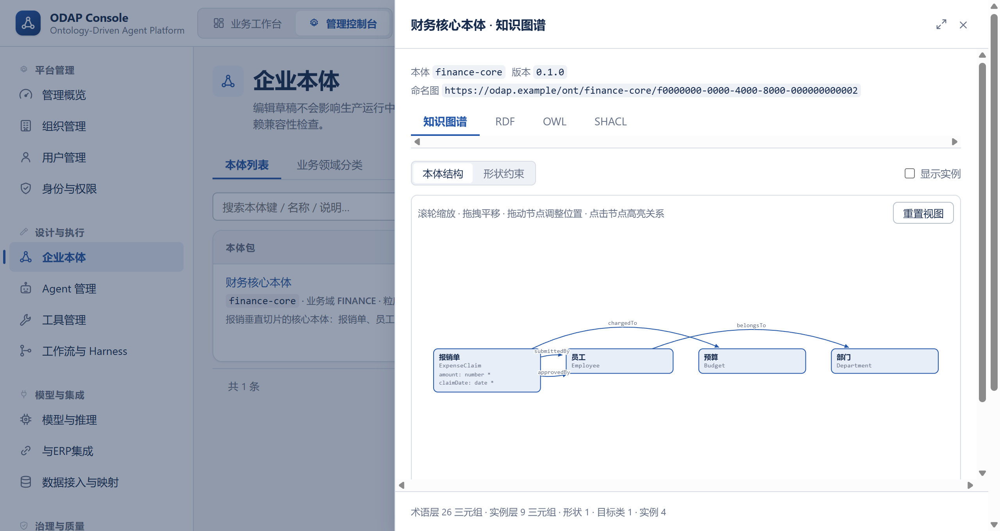

<sub>企业本体 · 知识图谱：类 / 关系 / 实例与形状约束同屏可见，「业务应用」就是一套本体</sub>

</div>

---

## 🧭 为什么需要它

大模型接进企业之后，真正的麻烦从来不是「答不出话」，而是这四件事：

| 问题 | 常见做法 | ODAP 的做法 |
| --- | --- | --- |
| 规则散落 | 把制度文档塞进提示词，指望模型自己记住 | 规则**建模成企业本体**（RDF / OWL / SHACL），可校验、可版本化、可发布 |
| 模型自由发挥 | 生成什么就执行什么 | 业务目标先被本体**逐条规则校验**，产出受控执行计划 |
| 外部写入失控 | 智能体直接调 ERP 接口 | 外部写入工具必须**人工审批确认**后才触达外部系统 |
| 出事查不到 | 只有一堆日志 | 审计事件**哈希链**留痕 + 证据包，追加写、不可改、可回溯 |

> 一句话：**先有语义，再有智能；先有治理，再有自动化。**

| 问题 | 常见做法 | ODAP 的做法（知识库） |
| --- | --- | --- |
| 企业知识散在文档里，问无依据 | 把整个文档目录塞进提示词 | 文档上传后**分块 → pgvector 向量嵌入 → 按本体约束抽取成图**；检索与图互相印证，回答可溯源。未配置嵌入模型时**明确报错，不假装能答** |

---

## ✨ 核心能力

### 🧬 企业本体是语义中枢，也是「业务应用」

业务应用页展示的**不是智能体清单，而是企业本体清单**——一套本体（业务对象 + 规则）就是一套可被业务用户使用的应用。
本体支持 RDF / OWL / SHACL 三套透视：结构化知识图谱、机器可读语义、以及可执行的形状约束。

- **知识图谱视图**：类与关系、实例开关、形状约束层级（形状 → 目标类 → 约束项）
- **源码视图**：RDF / OWL / SHACL 原文，语法高亮 + 页内检索 + 溯源元信息
- **生命周期门禁**：`DRAFT → VALIDATING → VALID/APPROVED → PUBLISHED`；未通过校验的版本**禁止发布**
- **删除即校验**：类别下仍有本体内容时不允许删除，只支持停用

### 🤖 AI 业务助手：按本体规则审查，而不是凭感觉回答

在「AI 业务助手」里选一套本体作为**审查依据**，用自然语言描述业务目标，系统会把请求逐条对照本体的规则校验，并给出结论。
任务详情页保留**完整的本体处理过程链路**，每一步都能说明「依据哪条规则、得出什么判断」。

### 📚 知识库：企业文档变成可检索、可溯源的知识

文档（Word / PDF / Markdown / Excel）上传后走真实处理管道：解析 → 分块 → **pgvector 1024 维嵌入** → 按本体约束抽取结构化知识入三元组图；向量检索与图查询互相印证。任务进度实时可见（PENDING → RUNNING → SUCCEEDED / FAILED），失败可重试、原因如实展示——嵌入模型未接入时上传前置校验**直接拒绝**，不产出空向量装样子。

### 🧠 推理引擎：本体规则不只是文档，是可执行的推理机

Go 自研推理内核，内置 RDFS 与 OWL 2 RL 规则集（代码承载本体、库存启停开关）：

- **前向推理**（Forward Chaining）：规则驱动派生新三元组，逐迭代推进并落账派生记录
- **后向推理**（Backward Chaining）：给定目标反推证据链，结论必须能说出「依据哪条规则」
- **增量推理**：本体版本演进时只重算受影响部分
- **一致性检查**：反例检测 + 约束校验，矛盾如实上报
- 对外提供 **gRPC 契约**（`contracts/proto/reasoning.proto`），推理运行全程留痕，派生的动作自动进动作台账

### 🔁 A2A 协同：平台即 Agent，智能体之间说同一种话

实现 Google **Agent2Agent** 协议要点：

- **Server 发布**：`GET /.well-known/agent.json` 实时装配 Agent Card——技能汇总自 registry，url 按请求 Host 构造，绝不落静态数据
- **JSON-RPC 2.0 网关**：`POST /api/v1/a2a` 单端点，方法白名单 `message/send`、`tasks/sendSubscribe`（SSE 推流）、`tasks/get / list / cancel`；任务状态映射 Run 17 态 → A2A 4 态
- **远程注册表**：登记远端 A2A Server 的地址与出站认证引用（环境变量名），明文凭据绝不落库；连通性探测如实记录结果
- 缺省路由 fail-closed：没有可执行的智能体配置时明确报错，不伪造任务完成

### 🎯 动作管理：每一次行动都是一等公民

`QUERY / UPDATE / INFER / ACTION / TOOL` 五类动作节点统一落账，详情页展示 **PROV-O 溯源命名图**（`prov:{tenant}:{action_id}`），支持 Turtle 导出与 **pgvector 相似动作检索**——历史上相似的处理先例一目了然。工具调用、推理派生、审批结果、A2A 任务全部汇聚于此，构成平台的行为总账。

### 🔧 工具即真实执行：没有 mock，也不会假装成功

工具管理页写得明明白白（这也是系统的真实行为）：

> 测试调用为**真实执行**：服务端按工具执行契约派发真实执行器（ERP 端口 / 文档解析 / SHACL 校验 / 模型治理网关 / 审计哈希链），结果如实写入调用记录。外部写入（EXTERNAL_WRITE）工具需**审批确认后**才会触达外部系统；无真实后端的能力（OCR / 预算系统）**明确报不可用，不降级、不造假**。

- 工具调用状态机：`PENDING_APPROVAL → APPROVED → EXECUTING → SUCCEEDED / FAILED / REJECTED`
- 重复审批返回 `409`，不会静默变成「已通过」
- 无真实后端的能力一律 fail-closed，返回明确错误而不是空结果的 `200`

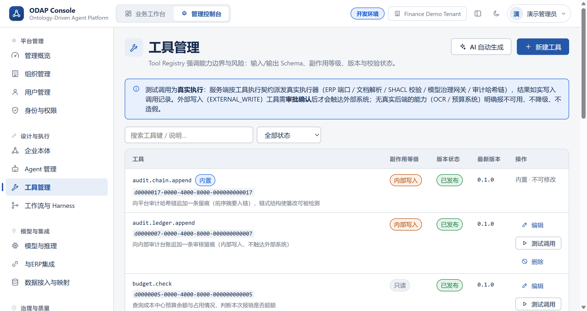

### 🔌 与 ERP 集成：类型是字典，适配器没实现就不许建连接

ERP 对接类型以**字典**建模，默认「用友 NC65」，另含「金蝶星空云」「SAP」：

| 类型 | 适配器状态 | 行为 |
| --- | --- | --- |
| 用友 NC65 | 已实现（默认） | 可创建连接、可做连通性测试 |
| 金蝶星空云 | 未实现 | 字典已建模，创建连接**直接拒绝** |
| SAP | 未实现 | 字典已建模，创建连接**直接拒绝** |

连接凭据与模型端点同一套硬约束：**AES-256-GCM 信封加密**落库，界面只回显打码值，
明文绝不进 SQL 参数、审计、日志、SSE 或 HTTP 响应。

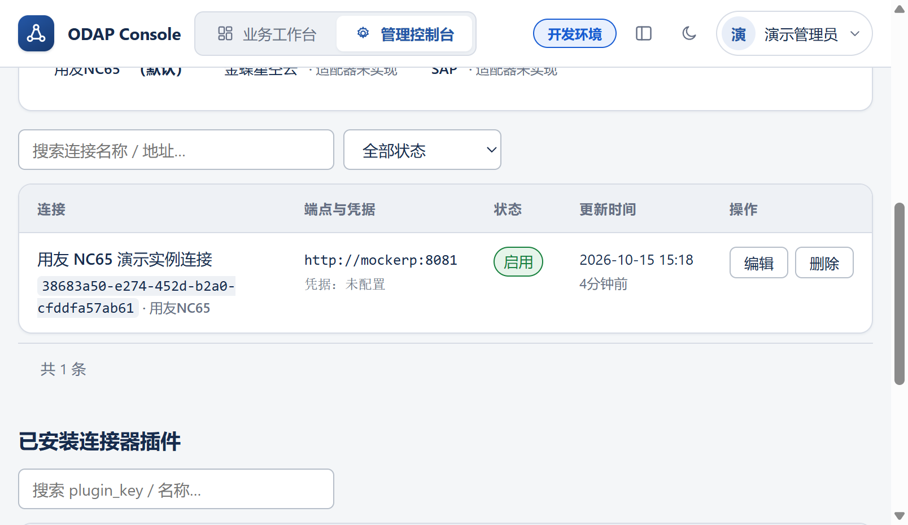

### 🔐 模型与推理：凭据密文优先，网关不绕过

- 端点凭据双路径且**密文优先**：界面录入 → 信封加密落库；同时保留环境变量引用作为回落
- 调用链必须经过完整治理链：限流 → 预算 → 缓存 → 路由 → 结构化输出
- 调用结果写入**用量账本**并回查；未装配有效端点时明确报配置错误，不静默降级

### 🧾 审计与证据：哈希链 + 只追加

`audit.audit_events` 与 `audit.evidence_records` 对应用角色**撤销 UPDATE / DELETE**，并由数据库触发器兜底；
每条事件带 `event_digest / prev_digest`，串成可验证的哈希链。

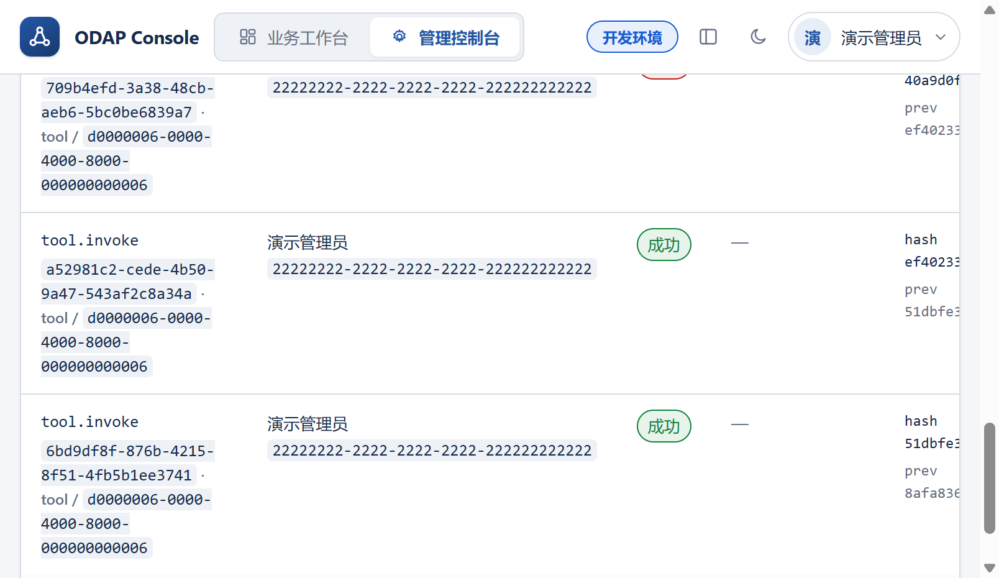

---

## 🏗 架构

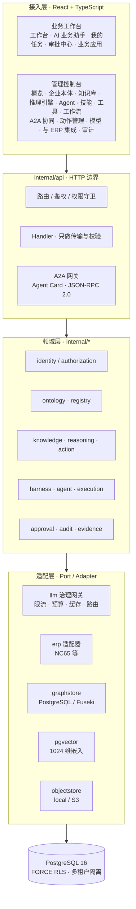

> 依赖方向自外向内，`internal/platform` 不依赖任何业务域；架构依赖方向由 `tests/unit` 持续守护。

---

## 🔁 一次受控执行的全链路

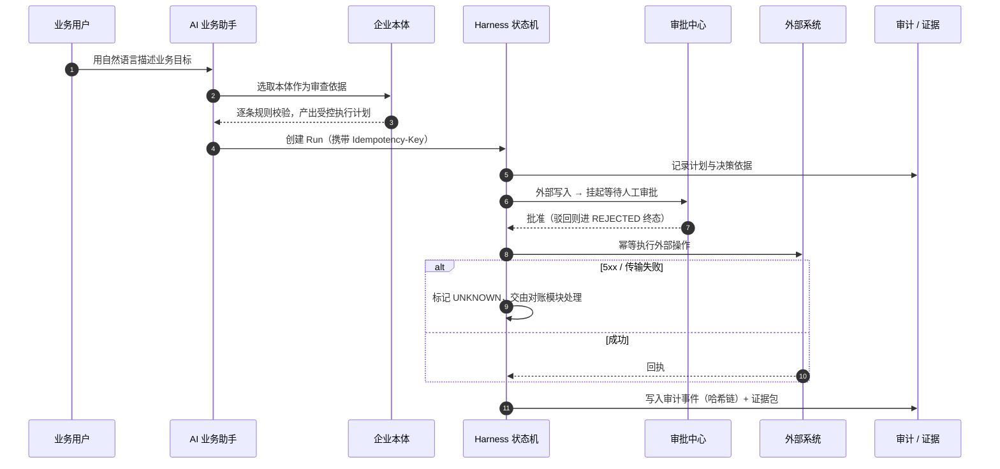

---

## 🚀 快速开始

前置：Docker + Docker Compose（Go 1.23 与 Node 20 可选，容器内已含工具链）。

```bash
cp .env.example .env            # 开发用默认值可直接使用
docker compose up -d --build    # 起最小拓扑
docker compose run --rm api seed --dataset finance-demo   # 导入演示数据
```

打开工作台，用演示账号登录：

| 项 | 值 |
| --- | --- |
| 前端工作台 | http://127.0.0.1:5173 |
| API | http://127.0.0.1:8080/api/v1 |
| 演示账号 | `demo.admin` / `odap-demo-2026` |

健康与就绪探测：

| 端点 | 地址 | 说明 |
| --- | --- | --- |
| API 存活 | http://127.0.0.1:8080/healthz | 不依赖数据库 |
| API 就绪 | http://127.0.0.1:8080/readyz | 探测数据库；依赖不可用返回 503 |
| 平台库 | 127.0.0.1:5432 | 库 `odap`；owner `odap`，运行时 `odap_app` |
| Mock ERP 库 | 127.0.0.1:5433 | 库 `mockerp`（仅开发拓扑的 ERP 靶机） |

可选依赖按 profile 启动：

```bash
docker compose --profile objectstore up -d     # MinIO（9000/9001）
docker compose --profile observability up -d   # 本地 OTLP collector（4317/4318）
```

> 生产部署不要设置 `ODAP_DEV_*`：后端不会装配 DevResolver，也不应注入身份头。

---

## 🖥 界面速览

<table>
<tr>
<td width="50%">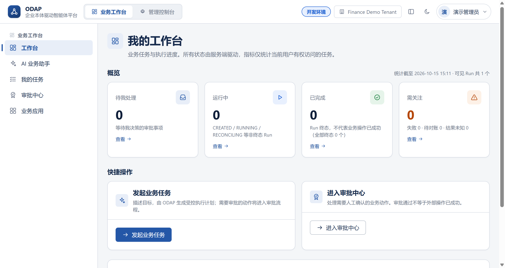<br/><sub><b>我的工作台</b> —— 所有状态由服务端驱动，指标只统计当前用户有权访问的任务</sub></td>
<td width="50%">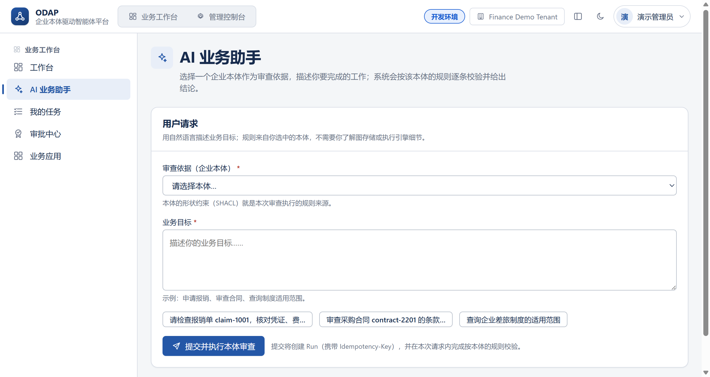<br/><sub><b>AI 业务助手</b> —— 先选本体作为审查依据，再描述业务目标</sub></td>
</tr>
<tr>
<td width="50%">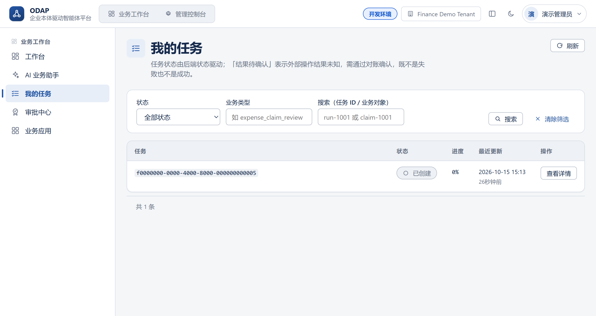<br/><sub><b>我的任务</b> —— 状态、业务类型、发起时间筛选与关键字搜索</sub></td>
<td width="50%">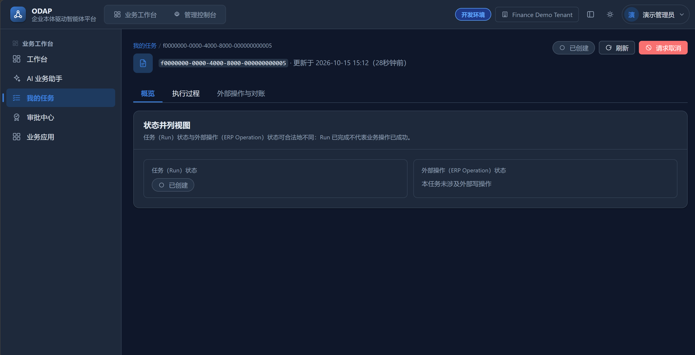<br/><sub><b>任务详情</b> —— 状态并列视图：Run 状态与外部操作状态可合法地不同，「Run 已完成」不代表业务操作已成功</sub></td>
</tr>
<tr>
<td width="50%">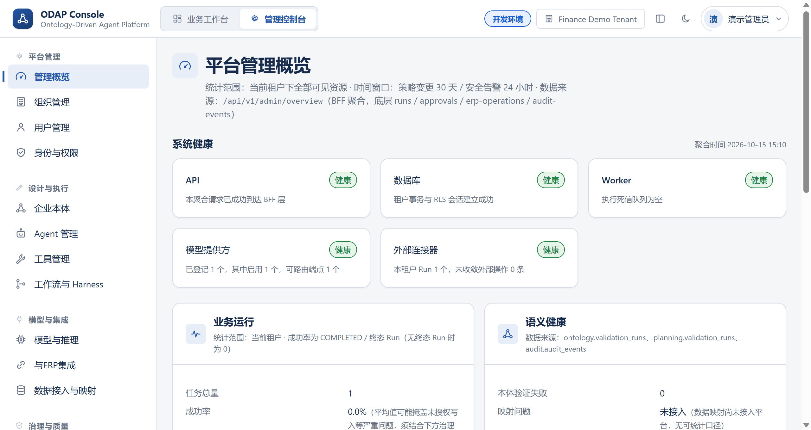<br/><sub><b>平台管理概览</b> —— 系统健康 / 业务运行 / 语义健康 / 治理与质量分层呈现</sub></td>
<td width="50%">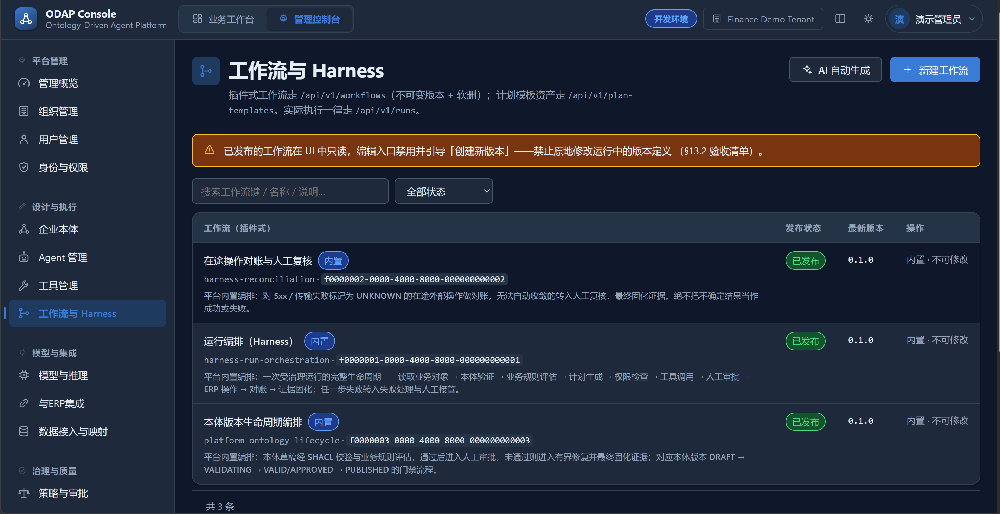<br/><sub><b>工作流与 Harness</b> —— 已发布工作流在 UI 中只读，禁止原地修改运行中的版本定义</sub></td>
</tr>
</table>

---

## 📁 目录结构

```
cmd/            api / worker / migrate / mock-erp —— 只做装配、配置读取、启动与优雅关闭
internal/       领域逻辑（20 个一级包）：api / identity / authorization / registry /
                ontology / knowledge / reasoning / action / harness / agent / execution /
                erp / docingest / tools / toolruntime / audit / evidence / llm / seed / platform
contracts/      对外契约：openapi.yaml、gRPC（reasoning.proto）与 JSON Schema
migrations/     平台库迁移（mockerp/migrations 负责 Mock ERP 库，账号与生命周期独立）
deployments/    compose Dockerfile、nginx 模板、OTel 配置、运维脚本
datasets/       演示与评估数据集（finance-demo 为可运行样例，含 Mock ERP 启动种子）
ontology-packages/  本体包（Turtle 等）
web/            React + TypeScript 前端
tests/          跨模块测试：unit / contract / integration / e2e / security / fault-injection
tools/          contract-lint、gates（交付门禁）、ci（流水线脚本）、本地验证脚本
assets/readme/  README 界面截图
```

组织原则：

1. `cmd/` 只负责初始化依赖、读配置、启动服务、处理关闭信号。
2. `internal/` 负责领域逻辑；HTTP Handler 不实现业务规则。
3. `contracts/` 保存对外 API、事件与结构化输出契约。
4. `tests/` 保存跨模块测试；各模块仍可在自身目录内保留紧邻代码的单元测试。

---

## 🧪 测试与门禁

| 层 | 目录 / 命令 | 前置条件 | 覆盖内容 |
| --- | --- | --- | --- |
| 单元测试 | `internal/**/*_test.go`、`tests/unit` | Go | 规则、状态机、授权决策、查询编译、参数校验、幂等键；架构依赖方向 |
| 契约测试 | `tests/contract`、`make lint` | Go | OpenAPI 规范性（operationId 唯一、path 不重复、成功/失败响应声明、`$ref` 不悬空）、词表一致性 |
| 集成测试 | `tests/integration`、`-tags=integration` | PostgreSQL | 事务、RLS 跨租户隔离、Outbox/Inbox、操作账本、审批与回执 |
| 端到端测试 | `tests/e2e`、`-tags=e2e` | 运行中的 API | 从 API 走到业务终态：会话生命周期、探针诚实性 |
| 故障注入 | `tests/fault-injection`、`-tags=faultinjection` | PostgreSQL | 重复消息、失败入死信、去重短路 |
| 安全测试 | `tests/security` | Go / PostgreSQL | 匿名拒绝矩阵、越权与跨租户、秘密泄露 |
| 图存储自检 | `cmd/api graphstore-check`、`make test-graphstore` | 真实 SPARQL 引擎 | 适配器生成的 SPARQL 在真实引擎上合法、租户命名图强隔离、空白节点可寻址、写入条数精确与幂等、跨后端行为一致 |

图存储自检必须跑在**真实引擎**上：HTTP 替身只能验证「适配器发了什么请求、怎么解析响应」，
验证不了生成的查询是否合法（历史上适配器曾生成 4 词项的图模式，替身全绿而真实引擎语法报错）。

**发布硬门禁**由 `make gates` 与 CI 的 Quality Gate 共同保证：未授权外部写入、审批绕过、跨租户泄露、
重试导致的重复非幂等操作、把未知状态报告为成功、关键审计缺失、本体与规则回归，任一出现即阻断发布。

---

## ⚙️ 持续集成

[`.github/workflows/ci.yml`](.github/workflows/ci.yml) 组织 13 个作业，**所有实际命令都在 `tools/ci/*.sh` 中**，
因此本地 `bash tools/ci/run-all.sh` 与 CI 行为一致：

```
format → unit → migrate → contract → integration → semantic → e2e
→ security → fault_injection → graphstore → quality_gate → artifact → smoke
```

```bash
bash tools/ci/run-all.sh --no-smoke      # 跳过 compose 冒烟
bash tools/ci/run-all.sh --strict        # 发布前完整校验（等价 CI_STRICT=1）
bash tools/ci/run-all.sh --only 01,04    # 只跑指定阶段
```

安全测试、故障注入与图存储自检**不是「仅报告」任务**：它们是 Quality Gate 的输入，失败即阻断。

### 常用命令

```bash
make help                 # 列出全部目标
make build                # go build ./...
make test                 # go test ./...（包内单元测试）
make lint                 # 契约一致性门禁
make gates                # 交付门禁：路由可达性 + 租户上下文 + SQL 绑定 + 契约一致性
make ci                   # 本地完整流水线（与 .github/workflows/ci.yml 同源）
```

需要连接数据库或 API 的命令统一使用 `tools/dev-run.sh`（它在 compose 网络内执行 Go 命令）：

```bash
bash tools/dev-run.sh go test ./internal/api/...
bash tools/dev-run.sh go run ./cmd/api seed --dataset finance-demo
```

---

## 📐 关键工程约定

1. **租户上下文只有一个注入实现**：`internal/platform/pgxutil.TenantTx`。它通过
   `set_config('app.tenant_id', $1, true)` 注入——RLS 策略函数读的正是 `app.tenant_id`。
   历史上曾出现第二份实现写入另一个 GUC，使策略函数求值得到 NULL、租户隔离**静默失效**，
   因此该约束由 `tools/gates/tenant_context_gate.py` 静态守卫。
2. **契约先改文档再改代码**：[`contracts/openapi.yaml`](contracts/openapi.yaml) 是唯一机器可读真源，
   与状态 / 错误码 / 事件词表的取值一致性由 `make lint` 校验，路由注册与契约登记严格对齐。
3. **审计与证据只追加**：对应用角色撤销 UPDATE / DELETE，并由数据库触发器兜底。
4. **写操作幂等**：所有写操作读取并回显 `Idempotency-Key`；配置类列表统一 **cursor（keyset）分页，默认 10 行/页**，上限 200。
5. **失败不伪装成功**：能力未接入时返回明确错误（如 503），绝不返回空结果或 200。

---

## 🗺 路线图

- [x] 企业本体：RDF / OWL / SHACL 建模、校验、发布门禁
- [x] Harness 受控执行：状态机、租约、重试、对账
- [x] 工具真实执行 + 人工审批门禁
- [x] ERP 适配器（用友 NC65）与类型字典
- [x] 审计哈希链 + 证据包
- [x] 技能独立资源 + WASM 脚本工具执行器
- [x] 知识库：文档分块 → pgvector 嵌入 → 本体约束知识抽取入图
- [x] 推理引擎：前向 / 后向 / 增量推理 + 一致性检查（gRPC 契约）
- [x] A2A 协同：Agent Card 发布 + JSON-RPC 2.0 网关 + 远程注册表
- [x] 动作管理：五类一等动作 + PROV-O 溯源 + 相似动作检索
- [ ] OCR / 预算系统等真实后端接入（当前明确报不可用，不降级）
- [ ] 知识库嵌入模型一键配置向导（当前依赖「模型与推理」接入 1024 维嵌入端点）

---

## 📄 说明

- 对外契约唯一机器可读真源：[`contracts/openapi.yaml`](contracts/openapi.yaml)
- 许可证：[PolyForm Noncommercial License 1.0.0](LICENSE) —— 仅限**非商业用途**；商业使用需另行获得授权。

<div align="center">
<sub>如果这个项目对你有帮助，欢迎 Star ⭐ 与提 Issue。</sub>
</div>
